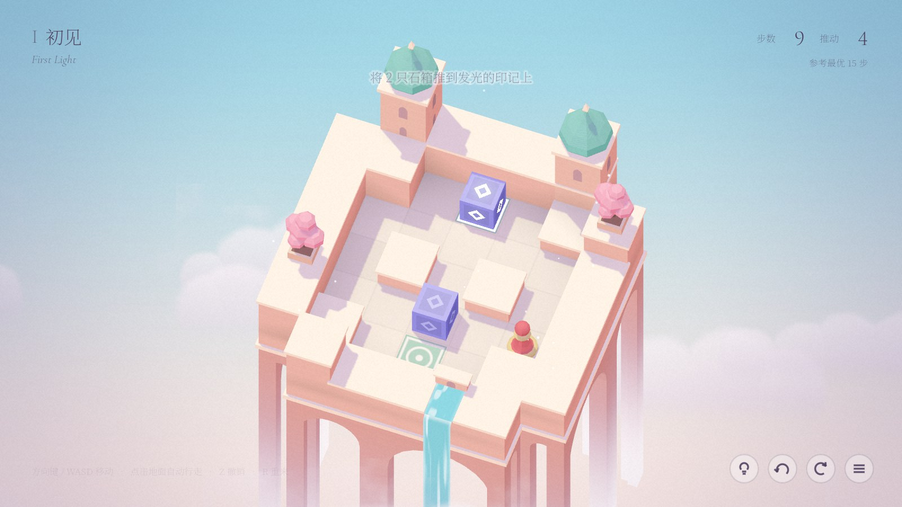
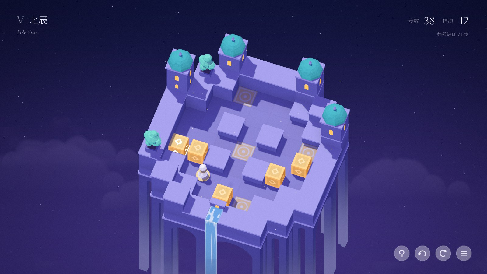
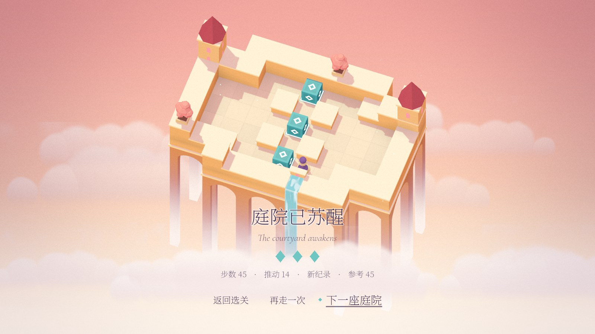
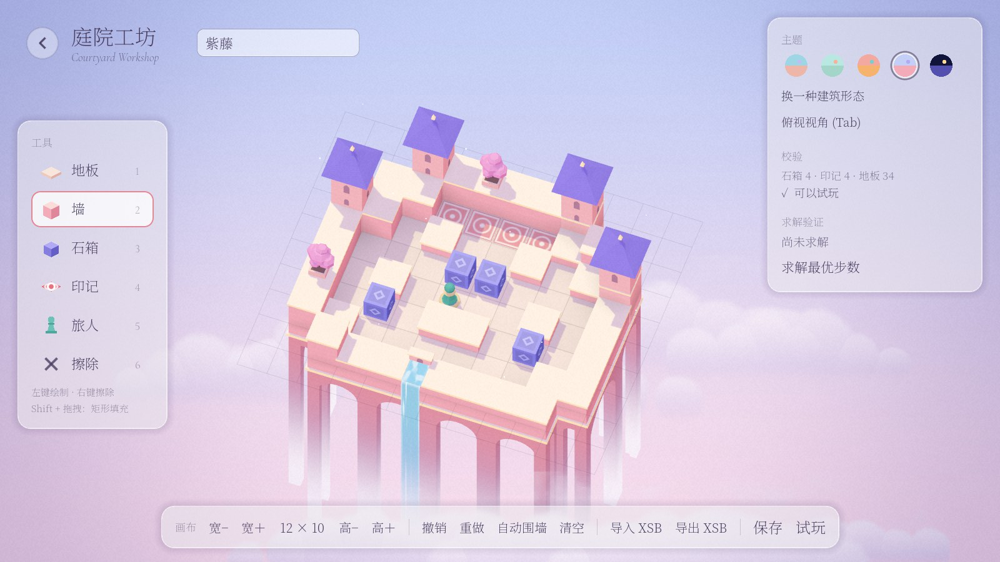

# 云上庭 · Courtyards in the Clouds

> 一款推箱解谜游戏（cloud-courtyard）
> Godot 4.6 · 纪念碑谷风格 · 含完整关卡流程与关卡编辑器


推动石箱，让沉睡在云端的庭院苏醒。五座风格各异的浮空庭院，每一座都由关卡数据**自动生长**成完整的建筑：塔楼、拱廊、瀑布、樱花树、通向云海的台阶。编辑器里随手画出的关卡，同样会长成一座漂亮的庭院。

| | |
|---|---|
|  |  |
|  |  |



---

## 运行

1. 安装 **Godot 4.6.x 标准版**（开发与测试使用 4.6.3 stable，无需 .NET 版）。
2. 用 Godot 打开本目录下的 `project.godot`，首次打开会自动导入资源。
3. 按 **F5** 运行。

工程不依赖任何插件或外部库。所有美术资源都是程序生成的，音效由 `tools/gen_audio.py` 合成，字体为 OFL 授权的子集。

## 操作

| 操作 | 键盘 / 鼠标 | 手柄 |
|---|---|---|
| 移动 / 推箱 | 方向键或 WASD（与屏幕方向一致） | 十字键 |
| 自动行走 | 点击地面（悬停时会预览路径）；点击相邻石箱即推动 | — |
| 撤销 / 重做 | Z / Y | B / Y |
| 重来 | R | Back |
| 提示 | H（后台求解，显示下一次推箱） | — |
| 暂停 | Esc | Start |

按住方向键可以连续行走。动画播放期间的输入会被缓冲，连续操作不会丢键。

## 功能一览

- **完整流程**
  - 标题 → 选关 → 关卡 → 通关结算 → 下一关
  - 选关界面会实时预览所选庭院：建筑从云海中升起
  - 通关后按顺序解锁下一关，进度与最佳步数自动保存
- **关卡内**
  - 入场时建筑从云海逐块升起，箱子落下，小兵在光点中现身
  - 箱子入位时，印记点亮并升起一束光柱
  - 推箱时小兵前倾，用头顶住石箱向前推
  - 全部入位后进入"庭院苏醒"演出：印记依次闪亮、窗户点亮、樱花盛放、台阶从云海升起、小兵转圈欢呼、镜头拉远
  - 结算面板显示步数、推动次数、最佳记录和参考最优步数，并按步数给出三枚花瓣的评价
- **提示**：从当前局面在后台线程求解，用路径虚线、发光石箱和浮动箭头标出下一次推箱。如果当前局面已陷入死局，会直接告知，引导玩家撤销。
- **庭院工坊（关卡编辑器）**，详见下文。
- **设置**：音乐与音效音量、全屏、纸张颗粒开关、重置进度。
- **声音**：每推一次箱子奏出五声音阶旋律中的下一个音，连续推动就是一段乐句；另有环境音乐。

## 关卡

五关全部原创，均由求解器验证可解，并写入最优步数（参考步数）。

| | 关卡 | 主题 | 石箱 | 最优步数 | 设计要点 |
|---|---|---|---|---|---|
| I | 初见 First Light | 晨曦 | 2 | 15 | 推箱的基本规则，加一个小小的"先让路" |
| II | 水镜 Mirror Pool | 碧水 | 2 | 26 | 印记就在墙角旁，顺手直推会把箱子卡进角落 |
| III | 掌灯 Lamplighter | 暮霞 | 3 | 45 | 中心的灯得先挪开；两端先点亮，中心最后 |
| IV | 紫藤 Wisteria Gallery | 紫境 | 4 | 60 | 只能经两道窄门进入画廊，先填两端，再填中间 |
| V | 北辰 Pole Star | 星夜 | 5 | 71 | 风车状的四颗外星，加上一颗堵住所有门洞的"北辰" |

## 庭院工坊（关卡编辑器）

编辑器与游戏共用同一套渲染和程序化建筑，**每一笔修改都会立即重建整座建筑**，所见即所得。

| 功能 | 说明 |
|---|---|
| 绘制工具 | 地板 / 墙 / 石箱 / 印记 / 旅人 / 擦除（快捷键 1–6）。左键绘制，右键擦除，拖拽可连续绘制，Shift + 拖拽为矩形填充 |
| 撤销 / 重做 | 按笔划记录（Ctrl+Z / Ctrl+Y） |
| 画布 | 宽高 4–16 可调；"自动围墙"一键给地板补全围墙 |
| 外观 | 五套主题一键切换；"换一种建筑形态"会重新随机建筑种子；Tab 在游戏视角与正上方俯视之间切换 |
| 实时校验 | 旅人是否放置、箱子数是否等于印记数、箱子和印记是否都可达、箱子是否卡在死角、地图边缘是否封闭 |
| 求解验证 | 后台求出**步数最优解**，显示最优步数与推动次数，并可一键演示最优解 |
| 试玩 | 直接进入游戏流程，返回后编辑状态（含撤销历史）完整保留 |
| 保存 | 保存到工坊（`user://levels/`），出现在选关界面的"工坊"分组 |
| XSB | 通过剪贴板导入或导出推箱子社区标准格式，可以直接粘贴经典关卡 |

## 系统设计

```
scripts/
├─ core/       纯逻辑层（不依赖渲染，可 headless 测试）
│   level_data.gd      关卡数据、JSON/XSB 读写、校验
│   sokoban_state.gd   规则：移动/推箱/撤销/重做，返回结构化 MoveResult
│   solver.gd          A* 求解器（步数最优）
│   pathfinder.gd      点击寻路（BFS）
├─ view/       表现层
│   world.gd           倾斜俯视的正交相机、灯光、环境、天空、云
│   monument_builder.gd 关卡网格 → 浮空建筑（程序化装饰）
│   mesh_kit.gd        程序几何工具（平直法线、挤出、旋转体、贴花）
│   theme_palette.gd   五套主题色板与材质库
│   board_view.gd      箱子/角色/印记的动画与反馈
│   character.gd       棋子小兵（玩家角色）
│   fx.gd              尘土、光点、光柱、花瓣
├─ game/       玩法控制：输入、关卡演出导演、提示服务
├─ ui/         界面：标题、选关、HUD、暂停、设置、结算、编辑器
└─ autoload/   Game（关卡、存档、设置、输入映射）、Sfx（音效与音乐）
```

### 逻辑与表现分离

- `SokobanState` 只关心网格规则。每次操作返回一个 `MoveResult`，包含：
  - 是否移动、是否推箱、被推的箱子 id
  - 受阻原因（墙或箱子）
  - 箱子是否进入或离开印记，是否通关
- `BoardView` 只根据 `MoveResult` 播放动画和音效，从不修改逻辑状态。
- 因此逻辑层可以在无渲染环境下单独测试，求解器、提示和编辑器校验也都复用同一份规则代码。

### 关卡数据格式

```json
{
  "format": 1, "id": "01", "name": "初见", "name_en": "First Light",
  "theme": "dawn", "seed": 1024, "par_moves": 15, "par_pushes": 5, "solution": "…",
  "map": [" #####", "##-.-##", "#-----#", "#-#$#-#", "#-@$--#", "##-.-##", " #####"]
}
```

- 地图兼容 XSB 字符：`#` 墙，`-` 地板，空格为虚空，`.` 印记，`$` 石箱，`*` 箱在印记上，`@` 旅人，`+` 旅人在印记上。
- 导入经典 XSB 时，空格是地板还是墙外的虚空，通过从旅人位置泛洪判定。
- `seed` 决定程序化建筑的随机部分，同一关每次生成都一致。
- `par_moves`、`par_pushes`、`solution` 由求解器写入，供结算评价和测试使用。

### 程序化建筑（MonumentBuilder）

输入关卡网格、主题和种子，输出一座完整的浮空庭院：

1. **台基与地面**：地面在 shader 中绘制砖缝与每块砖的细微色差。台基下方生成拱廊，每两格一个拱跨，向下延伸进雾里，底部有浅色檐口。
2. **墙**：带浅色压顶；压顶只在不与相邻墙相接的一侧外挑。
3. **防遮挡规则**：相机从斜上方看下来，高的构件会挡住它后方的格子。`_occludes_play()` 从每个可玩格朝相机方向发出视线，检查视线在升到构件高度之前是否穿过构件的占地（塔楼计入屋顶的高度和外挑）。所有高出地面的构件都要先经过这项检查：
   - 前排外墙和内部障碍墙自动降为矮墙
   - 塔楼和树只放在不会挡住可玩格的位置
4. **塔楼**：选外轮廓凸角中离中心最远的几处，彼此间隔至少 4 格。屋顶随主题变化：洋葱顶、方锥顶、尖塔、攒尖顶、穹顶。
5. **水渠与瀑布**：选在可见侧直墙的中段，水越过墙沿落入云海。
6. **台阶**：选最长的一段可见外侧边，从台基的小门沿外墙一路下行，没入云海。
7. **樱花树**：种在不遮挡视线的高墙顶上，带风吹摆动。
8. **假 AO 高度图**：把每格高度写入一张模糊过的浮点贴图，shader 比较"周围平均高度"和"当前点高度"，让墙根和角落自然变暗。

### 纪念碑谷风格着色（`shaders/mv_surface.gdshader`）

- **三面定色**：按面的朝向直接取顶、左、右三色，不依赖光照计算。左右以相机空间判断，斜面在三色之间平滑混合。
- **叠加效果**：在三面定色的基础上依次叠加：
  - 世界 Y 渐变：越往下越偏向主题的深色
  - 高度雾：最终融进与天空一致的雾色
  - 高度图假 AO
- **阴影**：方向光只负责投射清晰的彩色投影。背光面不再叠加自阴影，避免与三面定色重复变暗。
- **入场动画**：在顶点 shader 中完成。每个构件带一个延迟值，整座建筑由一个 `build_t` 参数驱动逐块升起，退场时反向沉入云海。
- **背景**：正交相机下 3D 天空球会退化为单色，所以天空用 2D Canvas 背景绘制：干净的竖向渐变，夜景加少量星星。建筑下方有柔和的云海。后处理加暗角与纸张颗粒。

### 求解器

- **搜索方式**：以"推一次箱子"为扩展单位的 A*。
  - 状态 = 箱子集合 + 推箱后玩家所在格
  - 代价 = 行走步数 + 推动次数，结果为**步数最优**
- **启发函数**：每个箱子到最近印记的推动距离之和。该函数可采纳且一致，所以首次出队的终局即为最优解。
- **剪枝**：
  - 死格：从印记反向"拉箱"也到不了的格子
  - 2×2 冻结死锁
- **运行方式**：在 `WorkerThreadPool` 后台线程执行，有状态数和时间上限，可随时取消。
- **离线版本**：`tools/solver.py` 用于设计关卡，两版求解器的结果交叉验证。

## 测试

```bash
# 逻辑单元测试：规则、撤销/重做、JSON/XSB 往返、寻路、校验、求解器最优性（与朴素 BFS 对比），
# 以及每个内置关卡的可解性与 par 值
godot --headless --path . --script res://tests/run_tests.gd

# 端到端冒烟测试：在真实游戏流程中依次用最优解通关每一关、检查结算，
# 再在编辑器中完成绘制/撤销/围墙/调整尺寸/换主题/求解/试玩/恢复（不写入玩家存档）
godot --headless --path . --fixed-fps 60 -- --smoke
```

## 工具脚本

| 脚本 | 用途 |
|---|---|
| `tools/solver.py` | 离线求解与关卡验证，`--write` 把 par 值和最优解写回关卡 JSON |
| `tools/gen_audio.py` | 用 numpy 合成全部音效与音乐，可复现 |
| `tools/subset_fonts.py` | 扫描代码与关卡中用到的字符，把思源宋体子集化（25 MB → 约 0.6 MB） |

## 扩展指南

- **新增关卡**：
  - 在 `levels/` 放入新的 JSON，按文件名排序后会自动出现在选关界面
  - 也可以在工坊中制作，再把 `user://levels/` 里的文件复制过来
  - 最后用 `tools/solver.py --write` 补全 par 值
- **新增主题**：
  - 在 `ThemePalette.THEMES` 中加入一套色板，并登记到 `LevelData.THEMES`
  - 在 `MonumentBuilder.ROOF_STYLE` 中为它选一种屋顶样式
- **新增格子类型**（如冰面、机关）：
  - 逻辑在 `LevelData.Cell` 与 `SokobanState._apply` 中扩展
  - 外观在 `MonumentBuilder` 中增加对应构件
  - 动画与音效通过 `MoveResult` 字段驱动

## 美术与版权

- 风格致敬《纪念碑谷》（ustwo games），但角色（棋子小兵）、建筑与全部资源均为原创或程序生成，未使用任何原作资源。
- 字体：思源宋体 Noto Serif SC、Cormorant Garamond，均为 SIL Open Font License，见 `fonts/` 中的许可文件。
